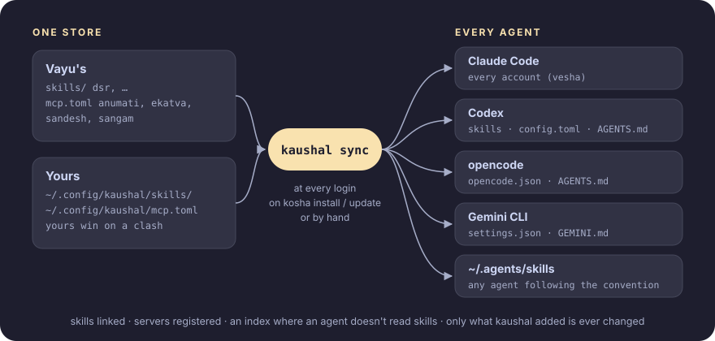

<p align="center">
  <picture>
    <source media="(prefers-color-scheme: dark)" srcset="assets/banner-dark.svg">
    <source media="(prefers-color-scheme: light)" srcset="assets/banner-light.svg">
    
  </picture>
</p>

<p align="center">
  <b>Every skill and tool, in every AI agent.</b><br>
  Claude Code on every account, Codex, opencode, Gemini CLI: whichever agent you open, it already has your skills and your tools.
</p>

<p align="center">
  <a href="https://github.com/Theyashsawarkar/kaushal/actions/workflows/ci.yml"></a>
  <a href="https://github.com/Theyashsawarkar/kaushal/releases"></a>
  <a href="LICENSE"></a>
  
</p>

> *Kaushal* (कौशल) is Sanskrit for "skill": what you teach once, every
> agent knows.

You use more than one AI agent: Claude Code (maybe on several accounts),
Codex, opencode, Gemini CLI. Each keeps its own skills, its own MCP servers
and its own global instructions, in its own format and folder. Teach one
agent a job and the others don't know it; add a tool to one and the others
can't use it; log in to a second Claude account and it has none of them.

**kaushal** keeps your skills and tools in one place and puts them into
every agent it finds, so whichever agent you open, in whichever account,
has all of them:

- **Skills** are folders with a `SKILL.md`, the open
  [Agent Skills](https://agentskills.io) format: a description saying when
  to use it, step-by-step instructions, and helper scripts.
- **Tools** are MCP servers, listed once in `mcp.toml`.
- **`kaushal sync`** links the skills and registers the tools in each
  agent's own config, and runs at every login, so a newly installed agent
  or a new account gets everything without you doing anything.

It's part of [Vayu](https://github.com/Theyashsawarkar/vayu), and ships
Vayu's skills and tools, but works on its own: standard library Python, no
dependencies.

## How it works

<p align="center">
  
</p>

1. **One store.** Skills and MCP servers are kept in one place: Vayu's in
   this repository, yours in `~/.config/kaushal/`.
2. **Written into each agent's own config.** `kaushal sync` puts them
   where each agent already looks, in its own format: skills are linked
   (so editing one takes effect everywhere at once), servers registered,
   and agents that don't read skill folders get a short index of the
   skills in their instructions file. Nothing runs between an agent and
   its tools: each loads them the way it always does, however it's
   started ([ADR 2](docs/adr/0002-one-store-synced-into-each-agent.md)).
3. **Only its own.** It records what it added and never changes anything
   else ([ADR 4](docs/adr/0004-change-only-what-kaushal-added.md)).
4. **Always current.** It syncs at every login and whenever kaushal is
   installed or updated, so a new agent, account or tool is covered without
   asking
   ([ADR 5](docs/adr/0005-sync-at-login-and-on-install.md)).

Why it's built this way: the [decision records](docs/adr/0001-record-architecture-decisions.md).

## Install

```sh
curl -fsSL https://raw.githubusercontent.com/Theyashsawarkar/kaushal/main/install.sh | bash
systemctl --user enable kaushal     # sync at every login
```

On Vayu, `kosha install kaushal` does both (Vayu starts the unit at login).
It needs Python 3.11 or newer and git.

## Use

| Command | What it does |
|---|---|
| `kaushal` | lists the skills, MCP servers and agents it found |
| `kaushal sync` | gives every agent all of it (`-n`: only say what would change) |
| `kaushal doctor` | checks every agent has everything; exit 1 if not |
| `kaushal unsync` | takes back everything kaushal added |
| `kaushal new NAME` | starts a skill of your own in `~/.config/kaushal/skills/NAME` |
| `kaushal path [NAME]` | where the skills (or one skill) live |

## Where each agent gets them

An agent counts when its command is on your PATH or its folder exists.

| Agent | Skills | MCP servers | Instructions |
|---|---|---|---|
| Claude Code | linked into `~/.claude/skills` (reads them itself) | `~/.claude.json`, and every [vesha](https://github.com/Theyashsawarkar/vesha) account's profile | (none needed) |
| Codex | linked into `~/.codex/skills` | a marked block in `~/.codex/config.toml` | index in `~/.codex/AGENTS.md` |
| opencode | reads `~/.agents/skills` itself | `~/.config/opencode/opencode.json` | tools in its `AGENTS.md` |
| Gemini CLI | index in `~/.gemini/GEMINI.md` | `~/.gemini/settings.json` | index in `GEMINI.md` |
| any agent | linked into `~/.agents/skills`, the convention's shared folder | | |

The **index** is a short block listing the tools and each skill's
description with the path of its SKILL.md; agents that don't read skill
folders themselves read it, and open a skill's file when a task matches.

**It never touches what isn't its own.** kaushal records what it added
(`~/.local/state/kaushal/state.json`) and changes only that and its marked
blocks; your other settings, servers and lines stay as they are, files are
written atomically and keep their permissions, and a TOML file is checked
before it's written. A skill folder or server of yours with the same name
wins (sync says so). Remove a skill or server from kaushal and the next
sync removes it from the agents; `kaushal unsync` takes everything back.

## Your own skills and tools

```sh
kaushal new standup          # ~/.config/kaushal/skills/standup/SKILL.md
$EDITOR ~/.config/kaushal/skills/standup/SKILL.md
kaushal sync
```

A skill's `description` is what agents choose it by: say what it does
**and when to use it**. Your skills stay on your machine; a skill of yours
with the same name as one of Vayu's replaces it.

Tools go in `~/.config/kaushal/mcp.toml`, in the same form as
[mcp.toml](mcp.toml):

```toml
[servers.mytool]
description = "What it gives agents"
command = "mytool"
args = ["mcp"]
env = { MYTOOL_AGENT = "{agent}" }   # {agent}: claude, codex, gemini, opencode

[servers.sangam]
enabled = false                      # leave one of Vayu's out
```

Only servers whose command is installed are registered.

## Vayu's skills

<!-- skills: written by scripts/site.py from skills/ -->
1 skill, with its full instructions on the [Skills page](https://theyashsawarkar.github.io/kaushal/skills/):

| Skill | What it does, and when an agent uses it |
|---|---|
| [`dsr`](skills/dsr/SKILL.md) | Write and send the user's Daily Status Report (DSR), the end-of-day email with a Time \| Tasks table, for any date. Reconstructs the day from the user's git commits, matches the format of their past DSRs, checks the timetable (start and end time, lunch break, no gaps) and sends it as a real HTML table through sandesh, as a reply-all in their DSR thread. Use when the user asks for a DSR, daily status report, daily report, status mail or end-of-day update, or to send or backfill one for a date. |
<!-- /skills -->

Settings for a skill stay on your machine, in `~/.config/kaushal/` (the `dsr` skill's in
`dsr.toml`, [example](skills/dsr/config.example.toml)).

## Vayu's tools

| Server | What it gives agents |
|---|---|
| [anumati](https://github.com/Theyashsawarkar/anumati) | root commands, run only after you approve each one |
| [ekatva](https://github.com/Theyashsawarkar/ekatva) | your phone: status, ring, lock, SMS and calls (asks you first), clipboard, files |
| [prasar](https://github.com/Theyashsawarkar/prasar) | posts to your X and LinkedIn: check, draft, propose (every post asks you first) |
| [sandesh](https://github.com/Theyashsawarkar/sandesh) | your Gmail and Google Chat (sends ask you first) |
| [sangam](https://github.com/Theyashsawarkar/sangam) | your GitHub pull requests (comments, reviews and merges ask you first) |

## In Vayu

On [Vayu](https://github.com/Theyashsawarkar/vayu), kaushal is part of the
desktop: every AI agent you start, from a terminal, tmux, an editor or the
launcher, has Vayu's skills and tools from its first message.

- **Installed by [kosha](https://github.com/Theyashsawarkar/kosha)** with
  the rest of Vayu's tools (`kosha install kaushal`; Vayu's installer does
  it). Its `install.sh` links `~/.local/bin/kaushal` and the login unit and
  runs the first sync.
- **Synced at every login**: `kaushal.service` is one of the units Vayu's
  session starts (`sway-session.sh`'s `UNITS`), and whenever kosha
  installs or updates kaushal. A tool you install with kosha reaches your
  agents at the next login, or at once with `kaushal sync`.
- **Every Claude Code account**: [vesha](https://github.com/Theyashsawarkar/vesha)
  keeps each account in its own profile; kaushal gives every profile the
  tools ([ADR 6](docs/adr/0006-every-claude-account.md)).
- **Vayu's tools for agents** are its MCP servers: anumati (root commands),
  ekatva (your phone), prasar (posts to X and LinkedIn), sandesh (mail and
  chat), sangam (pull requests).
  Each asks you before anything reaches other people or runs as root.
- **Vayu's rule**: a new skill or agent-facing tool goes into kaushal (a
  skill folder or an `mcp.toml` entry), never into one agent's config by
  hand, so every agent gets it. Vayu's `CLAUDE.md` and `AGENTS.md` say so,
  for the agents working on Vayu itself.
- **Your settings for Vayu's skills** stay on your machine, in
  `~/.config/kaushal/` (the `dsr` skill's in `dsr.toml`).
- **Check it**: `kaushal doctor`, or `kaushal` for what's there.

## License

MIT
